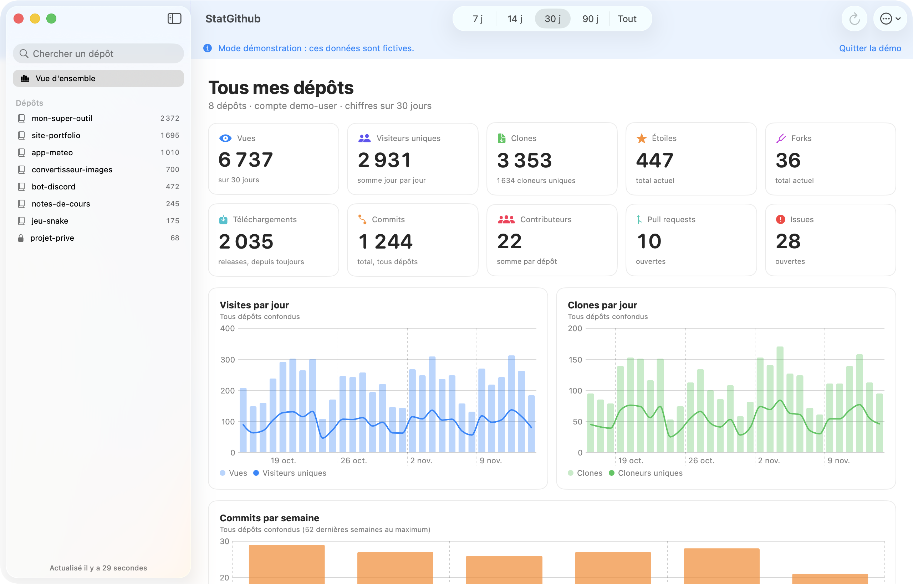
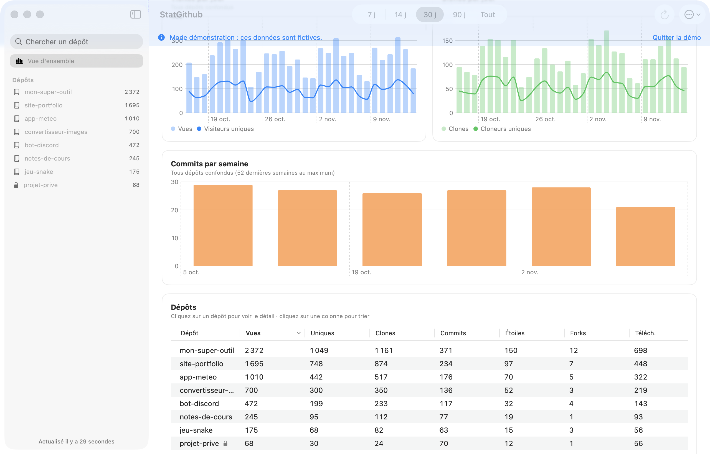
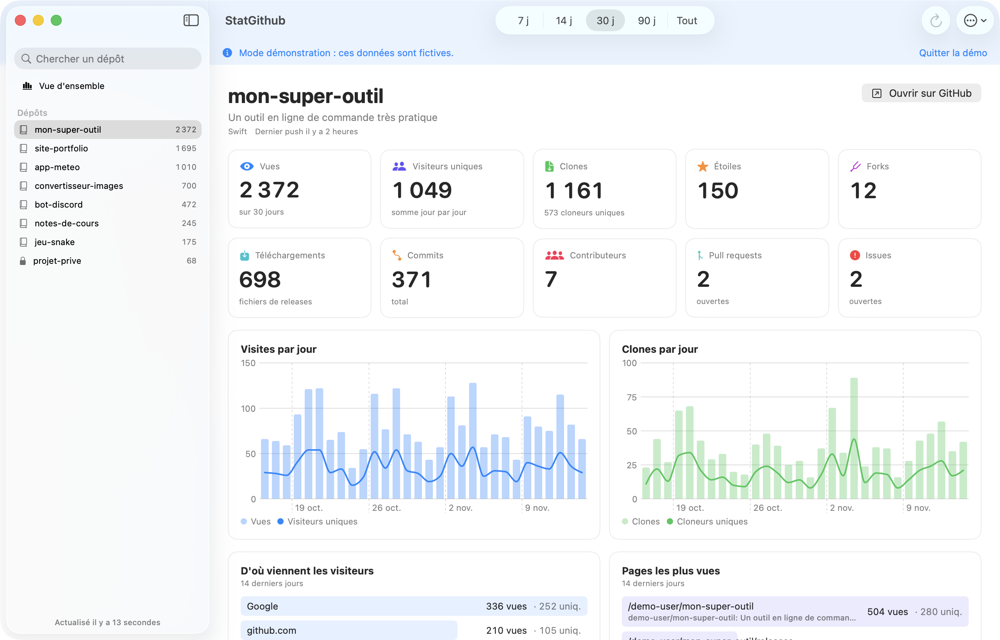
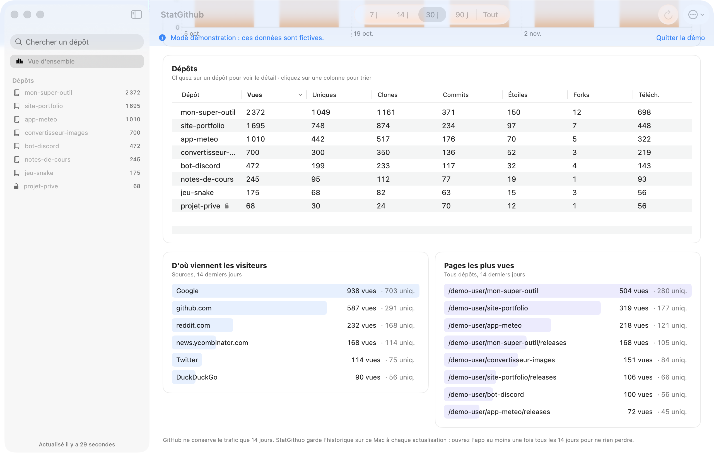

<div align="center">


# StatGithub

**Visitor statistics for all your GitHub repositories, in one Mac app.**


[🇫🇷 Français](README.md) · 🇬🇧 English



</div>

> The app's interface is in French.

## What it does

GitHub shows traffic one repository at a time, and only for the last 14 days. StatGithub puts everything in one place and **keeps the history on your Mac**:

- **Visits**: views and unique visitors per day, across all repositories or per repository.
- **Clones**: clones and unique cloners per day.
- **Traffic sources** and **most viewed pages** (last 14 days).
- **Activity**: commits (total and per week), contributors, open pull requests and issues, last push date.
- **Popularity**: stars (with their evolution), forks, release download counts.
- 7 d / 14 d / 30 d / 90 d / full-history periods, search, sorting, **CSV export**.
- **Demo mode** with fictitious data, no GitHub account needed.

## Screenshots

All screenshots show the demo mode (fictitious data).

| | |
|---|---|
|  |  |
| Weekly commits and repository table | Repository detail |



## Installation

1. Download `StatGithub-1.0.dmg` from the [Releases](../../releases) page, open it and drag **StatGithub** into *Applications*.
2. **First launch**: the app is not notarized by Apple (no paid developer account). **Right-click → Open** the app, then confirm. Alternatively, in Terminal:
   ```bash
   xattr -dr com.apple.quarantine /Applications/StatGithub.app
   ```
3. Optional check: compare the `.dmg` SHA-256 (`shasum -a 256 StatGithub-1.0.dmg`) with the one in the release notes.

Requirements: **Apple Silicon** Mac (M1 or later), **macOS 14 (Sonoma) or later**. Nothing else to install.

## Getting started

1. Open the app and click **"Essayer en mode démo"** (try demo mode) to see it with fictitious data.
2. For your own repositories, create a **classic GitHub token with the `repo` scope** (the button in the app opens the right GitHub page), paste it and click **Se connecter** (sign in).
3. Refresh with the ↻ button or **⌘R**.

**About the token**: it is stored in the macOS Keychain and only sent to `api.github.com`. The app only makes **read** (GET) requests. The `repo` scope is broad (GitHub offers no narrower scope to read traffic with a classic token): revoke the token on GitHub if you stop using the app.

**History**: GitHub only keeps traffic for 14 days. The history is saved to `~/Library/Application Support/StatGithub/historique.json` at each refresh. **Open the app at least once every 14 days** to avoid gaps.

## Compatibility and known limitations

- Tested on **macOS 26 (Apple Silicon)**, with the author's own account. **Not tested on macOS 14 or 15**, nor on Intel Macs (unsupported).
- Fine-grained tokens have not been tested; use a classic token with the `repo` scope.
- GitHub only provides traffic for repositories you own (or can write to). Forks are ignored.
- "Unique visitors" is the **day-by-day sum**: GitHub does not provide a unique total over a period.
- Days before the first refresh cannot be recovered (at best 14 days back).
- The weekly commits chart may take a minute to appear the first time (GitHub computes it on demand).
- The commit count is for the default branch.
- The GitHub API rate limit (5,000 requests per hour) can be reached with a very large number of repositories; the app reports it.

## Build from source

Requires Xcode (Swift 5.9 or later) on an Apple Silicon Mac.

```bash
./build_app.sh   # builds build/StatGithub.app (ad hoc signature)
./make_dmg.sh    # creates dist/StatGithub-1.0.dmg and its SHA-256
```

## Code layout

```
Sources/StatGithub/
  App.swift            entry point, window, shortcuts
  ContentView.swift    sidebar, toolbar, sign-in screen
  DetailViews.swift    overview and repository detail
  Components.swift     cards, charts, rankings
  Store.swift          state, refresh, history, aggregates, CSV export
  GitHubClient.swift   GitHub API calls
  Models.swift         data models
  Keychain.swift       token storage in the Keychain
  Demo.swift           demo-mode fictitious data
tools/make_icon.swift  generates the icon
build_app.sh / make_dmg.sh
```

## Contributing

Ideas and fixes are welcome: open an issue or a pull request. To try it without an account, use the demo mode.

## License

[MIT](LICENSE) © Wudstyz. See [THIRD_PARTY_NOTICES.md](THIRD_PARTY_NOTICES.md). Independent project, not affiliated with GitHub or Apple.
