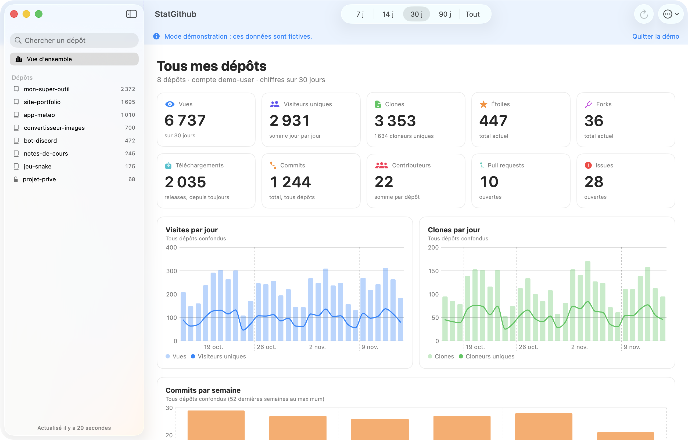
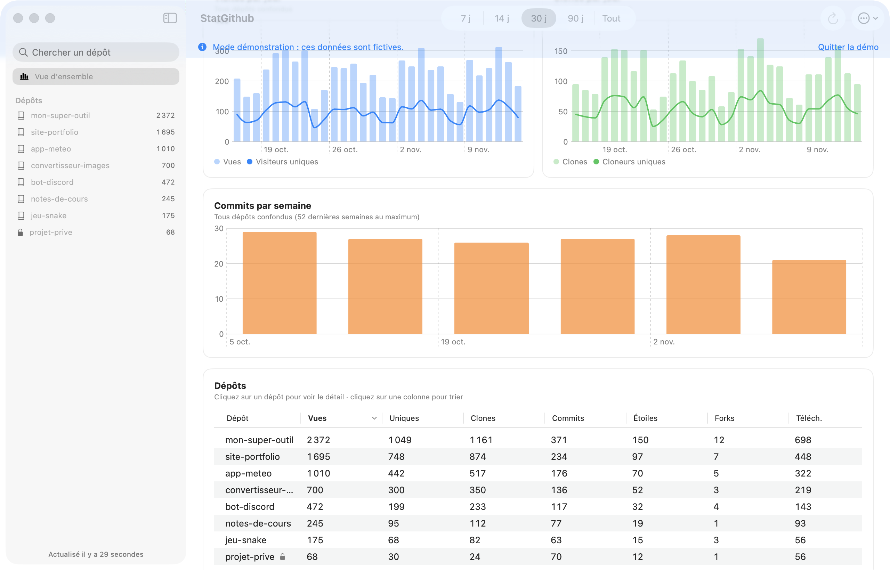
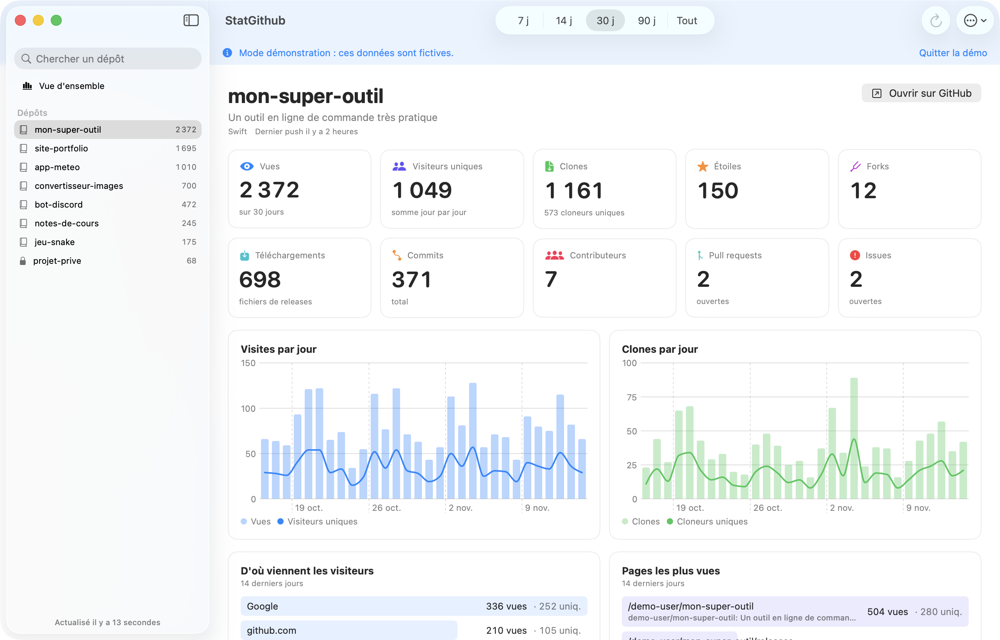
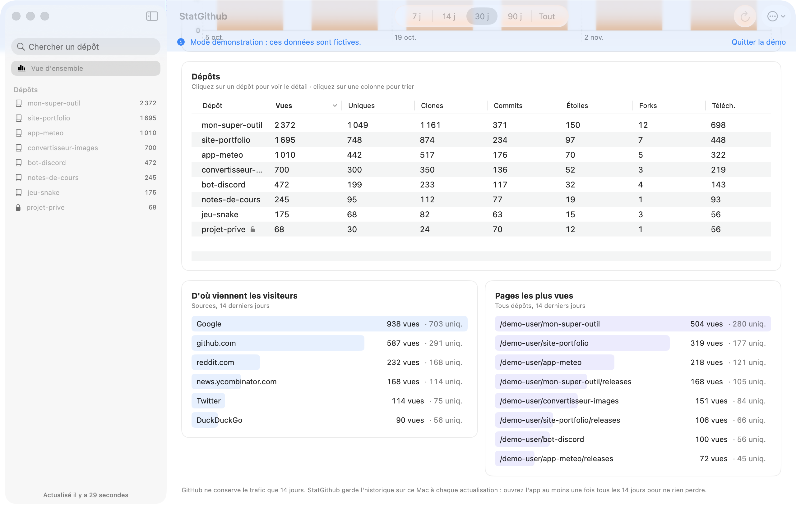

<div align="center">


# StatGithub

**Les statistiques de visiteurs de tous vos dépôts GitHub, dans une seule app Mac.**


🇫🇷 Français · [🇬🇧 English](README.en.md)



</div>

## Ce que ça fait

GitHub montre le trafic dépôt par dépôt, et seulement sur 14 jours. StatGithub rassemble tout au même endroit et **garde l'historique sur votre Mac** :

- **Visites** : vues et visiteurs uniques par jour, tous dépôts confondus ou par dépôt.
- **Clones** : clones et cloneurs uniques par jour.
- **Sources de trafic** et **pages les plus vues** (14 derniers jours).
- **Activité** : commits (total et par semaine), contributeurs, pull requests et issues ouvertes, date du dernier push.
- **Popularité** : étoiles (avec leur évolution), forks, téléchargements des fichiers de releases.
- Périodes 7 j / 14 j / 30 j / 90 j / tout l'historique, recherche, tri, **export CSV**.
- **Mode démo** avec des données fictives, sans compte GitHub.

Interface en français, thème clair.

## Captures d'écran

Toutes les captures montrent le mode démo (données fictives).

| | |
|---|---|
|  |  |
| Commits par semaine et tableau des dépôts | Détail d'un dépôt |



## Installation

1. Téléchargez `StatGithub-1.0.dmg` depuis la page [Releases](../../releases), ouvrez-le et glissez **StatGithub** dans *Applications*.
2. **Première ouverture** : l'app n'est pas notarisée par Apple (pas de compte développeur payant). Faites **clic droit → Ouvrir** sur l'app, puis confirmez. Autre méthode, dans Terminal :
   ```bash
   xattr -dr com.apple.quarantine /Applications/StatGithub.app
   ```
3. Vérification facultative : comparez la somme SHA-256 du `.dmg` avec celle indiquée dans la release (`shasum -a 256 StatGithub-1.0.dmg`).

Prérequis : Mac **Apple Silicon** (M1 ou plus récent), **macOS 14 (Sonoma) ou plus récent**. Rien d'autre à installer.

## Premiers pas

1. Ouvrez l'app et cliquez sur **« Essayer en mode démo »** pour voir à quoi ça ressemble, sans compte.
2. Pour vos vrais dépôts, créez un **jeton GitHub classique avec le droit `repo`** (le bouton de l'app ouvre la bonne page de GitHub), collez-le et cliquez sur **Se connecter**.
3. Actualisez avec le bouton ↻ ou **⌘R**.

**À propos du jeton** : il est stocké dans le Trousseau d'accès de macOS et n'est envoyé qu'à `api.github.com`. L'app ne fait que des requêtes de **lecture** (GET). Le droit `repo` est large (GitHub n'en propose pas de plus étroit pour lire le trafic avec un jeton classique) : révoquez le jeton sur GitHub si vous n'utilisez plus l'app.

**Historique** : GitHub ne conserve le trafic que 14 jours. L'historique est enregistré dans `~/Library/Application Support/StatGithub/historique.json` à chaque actualisation. **Ouvrez l'app au moins une fois tous les 14 jours** pour ne pas perdre de jours.

## Compatibilité et limites connues

- Testée sur **macOS 26 (Apple Silicon)**, avec le compte de l'auteur. **Non testée sur macOS 14 et 15**, ni sur Mac Intel (non supporté).
- Les jetons « fine-grained » (à granularité fine) n'ont pas été testés ; utilisez un jeton classique avec le droit `repo`.
- GitHub ne fournit le trafic que pour les dépôts dont vous êtes propriétaire (ou avec droit d'écriture). Les forks sont ignorés.
- « Visiteurs uniques » est la **somme jour par jour** : GitHub ne donne pas de total unique sur une période.
- Les jours antérieurs à la première actualisation ne sont pas récupérables (au mieux 14 jours en arrière).
- Le graphique des commits par semaine peut mettre une minute à apparaître la première fois (GitHub le calcule à la demande).
- Le nombre de commits est celui de la branche par défaut.
- La limite de l'API GitHub (5 000 requêtes par heure) peut être atteinte avec un très grand nombre de dépôts : l'app l'indique.

## Construire depuis les sources

Nécessite Xcode (Swift 5.9 ou plus récent) sur un Mac Apple Silicon.

```bash
./build_app.sh   # compile et crée build/StatGithub.app (signature ad hoc)
./make_dmg.sh    # crée dist/StatGithub-1.0.dmg et sa somme SHA-256
```

## Organisation du code

```
Sources/StatGithub/
  App.swift            point d'entrée, fenêtre, raccourcis
  ContentView.swift    barre latérale, barre d'outils, écran de connexion
  DetailViews.swift    vue d'ensemble et détail d'un dépôt
  Components.swift     cartes, graphiques, classements
  Store.swift          état, actualisation, historique, agrégats, export CSV
  GitHubClient.swift   appels à l'API GitHub
  Models.swift         modèles de données
  Keychain.swift       stockage du jeton dans le Trousseau
  Demo.swift           données fictives du mode démo
tools/make_icon.swift  génère l'icône
build_app.sh / make_dmg.sh
```

## Contribuer

Les idées et corrections sont les bienvenues : ouvrez une *issue* ou une *pull request*. Pour tester sans compte, lancez l'app avec le mode démo.

## Licence

[MIT](LICENSE) © Wudstyz. Voir [THIRD_PARTY_NOTICES.md](THIRD_PARTY_NOTICES.md). Projet indépendant, non affilié à GitHub ni à Apple.
